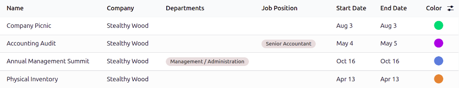

==============
Mandatory days
==============

Some companies have special days where specific departments, or the entire staff, is required to be
present. Time off is not allowed on those specific days.

These types of days are called *mandatory days* in Odoo. These can be configured to be company-wide,
or department specific. When configured, employees in the specified department or company are unable
to submit time off requests for these mandatory days.

Create mandatory days
=====================

No mandatory days are configured in Odoo by default. To create a mandatory day, navigate to
:menuselection:`Time Off app --> Configuration --> Mandatory Days`.

Click the :guilabel:`New` button in the top-left corner, and a blank line appears in the list.

Enter the following information on the new line:

- :guilabel:`Name`: Enter the name of the mandatory day.
- :guilabel:`Company`: This field is only visible in a multi-company database. The current company
  populates this field by default. Using the drop-down menu, select the company the mandatory day is
  for.
- :guilabel:`Departments`: This column is hidden by default. First, click the
  :icon:`oi-settings-adjust` :guilabel:`(additional options)` icon in the top-right corner, next to
  :guilabel:`Color`, and then click the checkbox next to :guilabel:`Departments` to reveal that
  column.

  Next, select the desired departments from the drop-down menu. Multiple departments can be
  selected; there is no limit to the amount of departments that can be added.

  If this field is left blank, the mandatory day applies to all departments (the entire company).
- :guilabel:`Job Position`: This column is hidden by default. First, click the
  :icon:`oi-settings-adjust` :guilabel:`(additional options)` icon in the top-right corner, next to
  :guilabel:`Color`, and then click the checkbox next to :guilabel:`Job Position` to reveal that
  column.

  Next, select the desired job position from the drop-down menu. Multiple job positions can be
  selected; there is no limit to the amount of job positions that can be added.

  If this field is left blank, the mandatory day applies to all employees.
- :guilabel:`Start Date`: Using the calendar picker, select the date the mandatory day starts.
- :guilabel:`End Date`: Using the calendar picker, select the date the mandatory day ends. If
  creating a single mandatory day, the end date should be the same as the start date.
- :guilabel:`Color`: If desired, select a color from the available presented options. If no color is
  desired, select the `No color` option, represented by a white circle. The selected color appears
  on the main **Time Off** app dashboard, in both the calendar and in the legend.

